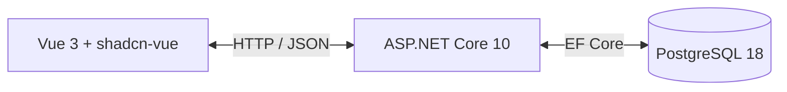

# DevTracker

Aplikacja do rozwijania projektów hobbystycznych: planowania zadań,
prowadzenia dokumentacji i mierzenia czasu pracy. Interfejs jest po angielsku.

## Co potrafi

- **Projekty:** tworzenie, edycja, usuwanie, archiwizacja i filtry statusów.
- **Zadania:** CRUD, priorytety, estymacja czasu, zależności, wyszukiwanie i paginacja.
- **Dokumentacja:** dokumenty Markdown z bezpiecznym podglądem.
- **Czas pracy:** start/stop sesji, licznik, historia i statystyki przeliczane w tle.
- **Konta:** rejestracja, logowanie, wylogowanie, role USER/ADMIN i prywatne dane.

Trzy reguły biznesowe: jedna aktywna sesja użytkownika, archiwizacja dopiero po
ukończeniu zadań i ukończenie zadania dopiero po jego wymaganych poprzednikach.

## Technologie i architektura

| Część | Technologie |
| --- | --- |
| Frontend | Vue 3, JavaScript, Vite, Tailwind CSS, shadcn-vue |
| Backend | ASP.NET Core 10, EF Core, ASP.NET Core Identity |
| Baza | PostgreSQL 18 |
| Testy i uruchomienie | xUnit, Vitest, Playwright, GitHub Actions, Docker Compose |



## Struktura projektu

```text
DevTracker/
├── backend/
│   ├── src/
│   │   ├── DevTracker.Api/             # HTTP, kontrolery i DTO
│   │   ├── DevTracker.Application/     # Serwisy i reguły biznesowe
│   │   ├── DevTracker.Domain/          # Encje i statusy
│   │   └── DevTracker.Infrastructure/  # EF Core, migracje, Identity i worker
│   └── tests/DevTracker.Tests/         # Testy jednostkowe i integracyjne
├── frontend/
│   ├── src/                           # Widoki, komponenty i klient API
│   └── e2e/                           # Testy przeglądarkowe Playwright
├── docs/                              # ERD i dokumentacja techniczna
├── .github/workflows/                 # GitHub Actions
└── compose.yaml                       # Uruchomienie aplikacji i bazy
```

## Uruchomienie

Wymagane: Git oraz uruchomiony Docker z Docker Compose.
Polecenia dla PowerShell:

```powershell
git clone https://github.com/Elleass/DevTracker.git
cd DevTracker
git switch project-mvp
if (-not (Test-Path .env)) { Copy-Item .env.example .env }
```

Ustaw własne `POSTGRES_PASSWORD` w `.env`, a następnie:

```powershell
docker compose up -d --build
```

Jeśli masz już `.env`, zachowaj go. Przy istniejącej bazie użyj jej dotychczasowego
hasła. Dane pozostają w wolumenie; migracje wykonują się automatycznie.
Kontener `migrate` powinien zakończyć się kodem 0.

| Usługa | Adres |
| --- | --- |
| Aplikacja | [localhost:8088](http://localhost:8088) |
| Swagger UI | [localhost:5033/swagger](http://localhost:5033/swagger) |
| OpenAPI | [localhost:5033/openapi/v1.json](http://localhost:5033/openapi/v1.json) |

Zarejestruj konto w aplikacji — otrzyma rolę USER. Nadanie ADMIN oraz start bez
kontenerów opisuje [instrukcja deweloperska](docs/development.md).
Konfiguracja Docker służy do uruchomienia lokalnego w środowisku Development.

Zatrzymanie aplikacji z zachowaniem danych: `docker compose down`.
Nie dodawaj `-v`, jeśli chcesz zachować bazę. Nie zapisuj `.env` ani haseł w Git.

## Dokumentacja i weryfikacja

- [Pełny ERD, relacje, architektura i reguły biznesowe](docs/technical.md)
- [Konfiguracja, uruchamianie lokalne i polecenia testów](docs/development.md)
- [Realizacja wymagań na 3.0, 4.0 i 5.0](docs/implementation-status.md)
- [GitHub Actions — build i testy](https://github.com/Elleass/DevTracker/actions)

Ostatnia pełna regresja: **70 testów backendu, 6 frontendu i 6 E2E**.
ERD obejmuje tabele aplikacji, ASP.NET Identity i historię migracji.
Historia zmian: `git log --oneline`. Przy oddaniu wskaż końcowy commit lub tag
oraz dołącz nagrane demo (3–5 minut).
