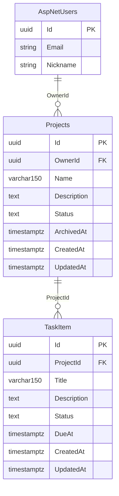

# Audyt API i modelu danych — punkty 01–04

Data weryfikacji: 2026-11-20. Branch: `project-mvp`.

- [x] 01. Inwentaryzacja Auth, Projects i Tasks; działające OpenAPI i Swagger UI.
- [x] 02. Encje, relacje, klucze obce, migracje PostgreSQL i odczyt po restarcie hosta backendu.
- [x] 03. Pięć operacji Projects CRUD, walidacja i przypadki brzegowe.
- [x] 04. Pięć operacji Tasks CRUD z zachowaniem powiązania z projektem.
- [x] 05. Walidacja DTO: wymagane pola, długości tekstów, enumy i daty.
- [x] 06. Globalny IExceptionHandler i ProblemDetails.
- [x] 07. Reguła archiwizacji z transakcją i wspólną blokadą projektu; testy współbieżności.
- [x] 09. Rejestracja, logowanie cookie, logout i testy czasu sesji.
- [x] 10. USER/ADMIN, RoleManager i lokalna komenda nadawania ADMIN.
- [x] 11. Izolacja Projects/Tasks po właścicielu i endpoint administracyjny tylko dla ADMIN.
- [x] 12. Paginacja Tasks z ograniczeniami i metadanymi.
- [x] 13. Filtr statusu i wyszukiwanie po tytule łączone z paginacją.

## Endpointy

Swagger UI: `/swagger`; dokument OpenAPI: `/openapi/v1.json`, tylko w Development.
W Swaggerze potwierdzono wyświetlanie operacji CRUD, modeli odpowiedzi
i opisów błędów; wykonanie niezalogowanego GET Projects zwróciło 401.
Wszystkie operacje poniżej wykonują również testy integracyjne z prawdziwym
PostgreSQL oraz rejestracją i logowaniem przez Identity cookies.

`P` oznacza `/api/projects/{projectId}`, `T` oznacza `P/tasks`.

| Metoda | Endpoint | DTO żądania | Sukces / model odpowiedzi | Błędy |
| --- | --- | --- | --- | --- |
| POST | `/api/auth/register` | `RegisterRequest` | 201 `UserResponse` | 400, 500 |
| POST | `/api/auth/login` | `LoginRequest` | 200 + cookie, bez body | 400, 401, 429, 500 |
| GET | `/api/auth/me` | — | 200 `UserResponse` | 401, 500 |
| POST | `/api/auth/logout` | — | 204 + usunięcie cookie | 401, 500 |
| GET | `/api/admin/users` | — | 200 `UserResponse[]`, tylko ADMIN | 401, 403, 500 |
| POST | `/api/projects` | `CreateProjectRequest` | 201 `CreatedProjectResponse` + Location | 400, 401, 409, 500 |
| GET | `/api/projects` | — | 200 `ProjectListResponse` | 401, 500 |
| GET | `P` | — | 200 `ProjectDetailsResponse` | 401, 404, 500 |
| PATCH | `P` | `UpdateProjectRequest` | 200 `UpdatedProjectResponse` | 400, 401, 404, 409, 500 |
| DELETE | `P` | — | 204, bez body | 401, 404, 500 |
| POST | `P/archive` | — | 204, bez body | 401, 404, 409, 500 |
| POST | `T` | `CreateTaskItemRequest` | 201 `CreatedTaskItemResponse` + Location | 400, 401, 404, 409, 500 |
| GET | `T` | `TaskListRequest` (query) | 200 `PagedResult<GetTaskItemResponse>` | 400, 401, 404, 500 |
| GET | `T/{taskItemId}` | — | 200 `GetTaskItemResponse` | 401, 404, 500 |
| PATCH | `T/{taskItemId}` | `UpdateTaskItemRequest` | 200, bez body | 400, 401, 404, 409, 500 |
| DELETE | `T/{taskItemId}` | — | 204, bez body | 401, 404, 500 |

GUID-y w ścieżkach mają ograniczenie `:guid`. Nieprawidłowy format nie dopasowuje
trasy i daje 404. Brak rekordu lub próba dostępu do cudzego projektu również
daje 404. Wszystkie operacje Projects i Tasks wymagają zalogowania.

Błędy wyjątków mają format `ProblemDetails` i `application/problem+json`.
Walidacja DTO daje 400 z `ValidationProblemDetails.errors`. Rejestracja może
zwrócić 400 z tablicą `IdentityError`, np. dla zbyt słabego hasła lub duplikatu
użytkownika. Nieoczekiwany błąd daje ogólne 500 z `traceId`; szczegóły są w logach.

## DTO i semantyka aktualizacji

| DTO | Pola i reguły |
| --- | --- |
| `RegisterRequest` | Email: wymagany, format e-mail, do 256 znaków; Nickname: wymagany, do 100; Password: wymagany, dalsze reguły Identity |
| `LoginRequest` | Email: wymagany, format e-mail, do 256; Password: wymagany |
| `CreateProjectRequest` | Name: wymagane, niepuste, do 150; Description: opcjonalne, do 4000 |
| `UpdateProjectRequest` | Name: opcjonalne, jeśli podane jako tekst: niepuste, do 150; Description: opcjonalne, do 4000; ProjectStatus: opcjonalna poprawna wartość enum |
| `CreateTaskItemRequest` | Title: wymagane, niepuste, do 150; Description: opcjonalne, do 4000; DueAt: opcjonalne |
| `UpdateTaskItemRequest` | Title: opcjonalne, jeśli podane jako tekst: niepuste, do 150; Description: opcjonalne, do 4000; Status i DueAt: opcjonalne; Status: poprawna wartość enum |

PATCH zmienia tylko wskazane pola. Pominięte `description`/`dueAt` zachowują
dotychczasową wartość, a jawne `null` ją usuwa. `name`, `title` oraz statusy
z wartością `null` pozostają bez zmian. Puste `{}` jest poprawną operacją bez zmian.

Nazwy projektów są unikalne w obrębie właściciela; porównanie jest dokładne,
z rozróżnieniem wielkości liter, bez automatycznego przycinania spacji.
Sprawdzenie działa przy tworzeniu i zmianie nazwy. Unikalny indeks zabezpiecza
również równoległe zapisy; jego naruszenie jest tłumaczone na 409.

Status projektu przekazuje się jako `projectStatus`: Idea = 0, Active = 1,
OnHold = 2, Completed = 3. Status zadania jako `status`: ToDo = 0,
InProgress = 1, Done = 2. API używa liczbowych wartości enum. `dueAt` przyjmuje
datę ISO 8601 z offsetem i jest zapisywane w UTC; może być null.

## Model PostgreSQL

`ApplicationUser` dziedziczy po `IdentityUser<Guid>`. Pozostałe tabele Identity
obsługują m.in. role, loginy, tokeny i claims; nie są dodatkowymi encjami domeny
projektów/zadań. Pliki Category i Tag są zakomentowanymi szkicami.

- PK: GUID, generowane przy dodaniu encji przez EF/Identity.
- Projects.OwnerId → AspNetUsers.Id: wymagany FK, usunięcie użytkownika z projektami blokowane przez RESTRICT.
- TaskItem.ProjectId → Projects.Id: wymagany FK; usunięcie projektu usuwa jego zadania przez CASCADE.
- Unikalny indeks Projects(OwnerId, Name); indeks TaskItem(ProjectId).
- Statusy przechowywane jako tekst; daty jako `timestamp with time zone`.
- CreatedAt/UpdatedAt ustawiane w `AppDbContext.SaveChangesAsync`.
- Repozytoria zapisują zmiany przez EF Core/Npgsql, nie w pamięci procesu.
- Compose PostgreSQL 18 korzysta z trwałego wolumenu `postgres_data`.

Migracje:

1. `20261021205406_InitialCreate` — Identity i Projects.
2. `20261025163513_AddTaskItems` — TaskItem i FK do Projects.
3. `20261120191217_EnforceUniqueProjectNames` — unikalny indeks właściciel/nazwa.
4. `20261120192155_SeedUserAndAdminRoles` — role USER/ADMIN i przypisanie istniejących kont do USER.

Wszystkie migracje zastosowano od zera w izolowanej bazie testowej. Nowe migracje
zastosowano również do lokalnej bazy `devtracker`, bez usuwania rekordów.
`dotnet ef migrations has-pending-model-changes` nie wykazało różnic modelu.

## Weryfikacja automatyczna

`CrudIntegrationTests` sprawdza:

- Pełne Projects CRUD, aktualizację samego statusu i czyszczenie opisu.
- Konflikt nazw na POST/PATCH, dozwoloną niezmienioną nazwę oraz tę samą nazwę u innego właściciela.
- Pełne Tasks CRUD, ProjectId, zmianę statusu, termin z offsetem i czyszczenie pól nullable.
- Błędy 400 dla pustych/za długich tekstów, brakujących wymaganych pól, niedozwolonych statusów i niepoprawnej daty; brak zmian danych po odrzuceniu żądania.
- Błędy 404 dla brakujących projektów i zadań oraz wszystkich operacji na cudzym projekcie.
- Odrzucenie odczytu/edycji/usuwania zadania przez niepasujący projectId.
- Stan migracji, FK obu relacji, blokadę usunięcia właściciela i kaskadę usunięcia zadań.
- Mapowanie naruszenia unikalnego indeksu na wyjątek aplikacyjny także z pominięciem sprawdzenia serwisowego.
- Trwałość: utworzenie użytkownika, projektu i zadania; pełne zamknięcie hosta aplikacji; utworzenie nowego hosta z tą samą bazą, ponowne logowanie i odczyt tych samych rekordów.
- Rejestrację, logowanie cookie, `/me`, duplikat rejestracji, słabe hasło i niepoprawne dane logowania.

`ExceptionHandlingTests` sprawdza 404, 409, bezpieczne 500, statusy błędnych
żądań, traceId i odpowiedź przy nagłówku Accept nieobsługiwanym przez writer.
`ApiDocumentationTests` sprawdza Swagger UI i jego zasoby, opisy wyjątków i modele
OpenAPI, niezalogowane 401 oraz brak dokumentacji w Production.

Testy bazy tworzą i usuwają wyłącznie własną bazę `devtracker_tests_<losowy-id>`.
Instrukcja uruchomienia: [README](../README.md).

Po rozszerzeniu zakresu dodano też testy `ArchiveProjectTests` i
`AuthAndArchiveIntegrationTests`: reguła archiwizacji bez HTTP, rzeczywista
archiwizacja z PostgreSQL, wylogowanie, sesja przed i po wygaśnięciu, brak
przedłużania sesji aktywnością, konfiguracja czasu sesji, role i odrzucenie
próby nadania sobie ADMIN przez rejestrację. Zegar w testach jest kontrolowany;
testy nie czekają rzeczywistych 30 minut.

Paginację, filtrowanie, literalne wyszukiwanie ILIKE i izolację z rolą ADMIN
potwierdza `TaskQueryIntegrationTests`. Domyślna strona ma 20 elementów,
maksymalna 100; błędne parametry dają 400. Filtry poprzedzają liczenie i
stronicowanie, a kolejność to CreatedAt/Id. Szczegóły kontraktu: README.

Aktualny przekrojowy przegląd wszystkich 18 wymagań oraz znane ograniczenia:
[code-review.md](code-review.md). Poza zakresem pozostają pełne artefakty do oddania.

`ProjectConcurrencyTests` wymusza cztery wyścigi między archiwizacją i zapisem
zadania. `LoginProtectionTests` sprawdza blokadę konta po błędnych hasłach i
ograniczenie loginu na IP; zablokowany login zwraca 401, limit żądań 429.
