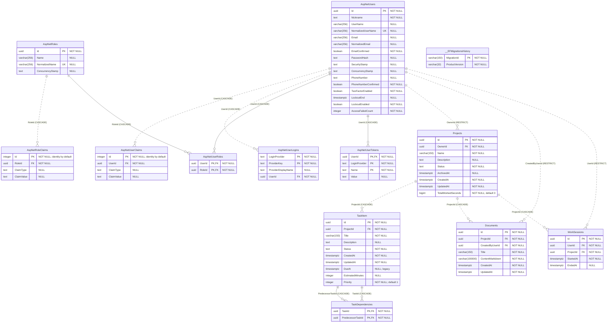
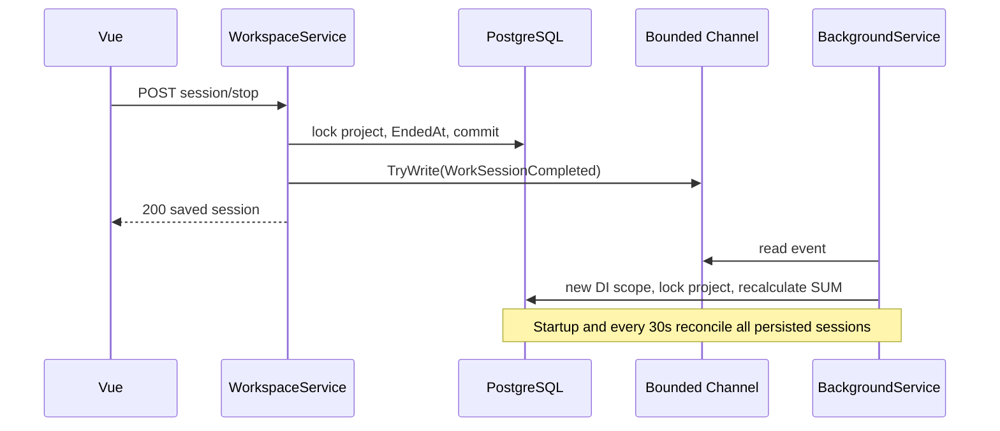

# Dokumentacja techniczna

## ERD — pełny schemat fizyczny PostgreSQL

Wersja dokumentacji: 2026-11-21. Schemat `public` po migracji
`20261120222853_AddTaskPlanning`: **13 tabel, 73 kolumn i 14 kluczy obcych**.
Diagram używa nazw tabel i kolumn z PostgreSQL, obejmuje pięć tabel biznesowych,
siedem tabel ASP.NET Identity oraz techniczną tabelę historii migracji.

Źródło weryfikacji: SQL wygenerowany ze wszystkich sześciu migracji przez
`dotnet ef migrations script` i snapshot modelu EF Core. W czasie aktualizacji
Docker był wyłączony, więc nie wykonano nowego odczytu katalogów działającej bazy.
Nie zmieniano danych ani schematu bazy.

Legenda: `PK` — klucz główny, `FK` — klucz obcy, `UK` — pojedyncza kolumna
z bezwarunkowym indeksem UNIQUE. Kilka pól `PK` w jednej tabeli tworzy jeden
klucz złożony. `NULL`/`NOT NULL` określa dopuszczalność braku wartości.
`varchar(n)` oznacza `character varying(n)`, a `timestamptz` —
`timestamp with time zone`. Linia ciągła oznacza FK należący do PK dziecka,
przerywana — pozostałe FK. Każdy FK jest wymagany; rodzic może nie mieć dzieci.
Etykieta relacji podaje kolumnę FK i regułę `ON DELETE`.

### Indeksy i ograniczenia

Każdy PK ma automatyczny indeks unikalny. Poniżej wszystkie dodatkowe indeksy
po zastosowaniu migracji (bez usuniętego `IX_Projects_OwnerId`).
Dla indeksu UNIQUE PostgreSQL dopuszcza wiele NULL; `EmailIndex` nie jest unikalny.
Indeks częściowy aktywnej sesji nie oznacza globalnej unikalności `UserId`.

| Tabela | Indeks | Kolumny | Rodzaj / warunek |
| --- | --- | --- | --- |
| `AspNetUsers` | `EmailIndex` | `NormalizedEmail` | B-tree |
| `AspNetRoleClaims` | `IX_AspNetRoleClaims_RoleId` | `RoleId` | B-tree |
| `AspNetUserClaims` | `IX_AspNetUserClaims_UserId` | `UserId` | B-tree |
| `AspNetUserLogins` | `IX_AspNetUserLogins_UserId` | `UserId` | B-tree |
| `AspNetUserRoles` | `IX_AspNetUserRoles_RoleId` | `RoleId` | B-tree |
| `Documents` | `IX_Documents_CreatedByUserId` | `CreatedByUserId` | B-tree |
| `Documents` | `IX_Documents_ProjectId_UpdatedAt` | `ProjectId, UpdatedAt` | B-tree |
| `Projects` | `IX_Projects_OwnerId_Name` | `OwnerId, Name` | UNIQUE |
| `TaskDependencies` | `IX_TaskDependencies_PredecessorTaskId` | `PredecessorTaskId` | B-tree |
| `TaskItem` | `IX_TaskItem_ProjectId` | `ProjectId` | B-tree |
| `WorkSessions` | `IX_WorkSessions_ActiveUser` | `UserId` | UNIQUE; `WHERE "EndedAt" IS NULL` |
| `WorkSessions` | `IX_WorkSessions_ProjectId_StartedAt` | `ProjectId, StartedAt` | B-tree |
| `WorkSessions` | `IX_WorkSessions_UserId_StartedAt_Id` | `UserId, StartedAt, Id` | B-tree |
| `AspNetRoles` | `RoleNameIndex` | `NormalizedName` | UNIQUE |
| `AspNetUsers` | `UserNameIndex` | `NormalizedUserName` | UNIQUE |

Ograniczenia CHECK w bazie:

| Nazwa | Tabela | Warunek |
| --- | --- | --- |
| `CK_Dependency_NotSelf` | `TaskDependencies` | `TaskId <> PredecessorTaskId` |
| `CK_WorkSession_Time` | `WorkSessions` | `EndedAt IS NULL OR EndedAt >= StartedAt` |
| `CK_Task_Estimate` | `TaskItem` | `EstimatedMinutes IS NULL OR EstimatedMinutes BETWEEN 1 AND 525600` |
| `CK_Task_Priority` | `TaskItem` | `Priority BETWEEN 0 AND 2` |

Dodatkowe szczegóły odwzorowania:

- `ApplicationUser` → `AspNetUsers`; `Project` → `Projects`; `TaskItem` → `TaskItem`;
  `WorkSession` → `WorkSessions`; `Document` → `Documents`;
  `TaskDependency` → `TaskDependencies`.
- `Projects.Status` i `TaskItem.Status` są tekstem, nie typami ENUM PostgreSQL.
  Dozwolone statusy waliduje aplikacja. `Priority` jest liczbą 0=Low, 1=Normal,
  2=High; domyślna wartość SQL to 1. `TotalWorkedSeconds` ma domyślną wartość SQL 0.
- `DueAt` pozostaje nullable w bazie dla zachowania wcześniejszych danych;
  formularze używają `EstimatedMinutes`. `Description` jest typu `text`, mimo
  dodatkowych limitów długości w DTO. `ContentMarkdown` ma limit 100000 w bazie.
- `AspNetUserClaims.Id` i `AspNetRoleClaims.Id` są kolumnami IDENTITY BY DEFAULT.
  Identyfikatory UUID generuje EF/Identity; migracje nie ustawiają SQL DEFAULT
  generującego UUID.
- `WorkSession.DurationSeconds` jest obliczane w kodzie i nie jest kolumną.
  Cookies i klucze Data Protection nie są dodatkowymi tabelami tego schematu.
- `__EFMigrationsHistory` nie ma FK; zawiera identyfikator i wersję produktu
  dla każdej zastosowanej migracji. Role USER/ADMIN są rekordami w `AspNetRoles`.
- FK użytkownika do danych biznesowych mają RESTRICT, FK projektu i FK Identity
  mają CASCADE. Oba FK `TaskDependencies` mają CASCADE; dodatkowo serwis blokuje
  usunięcie zadania wymaganego przez inne zadanie. Usunięcie całego projektu
  obejmuje zadania, zależności, dokumenty i sesje.

## Reguły i współbieżność

1. Jedna aktywna sesja per użytkownik. WorkspaceService sprawdza regułę,
   a indeks bazy rozstrzyga równoległe starty także w różnych projektach.
   Naruszenie konkretnego indeksu jest mapowane na ActiveWorkSessionException/409.
2. Projekt z niezakończonym zadaniem nie może być archiwizowany. Archiwizacja
   i wszystkie zmiany projektu/zadań współdzielą SELECT FOR UPDATE rekordu
   projektu i transakcję Read Committed. Po archiwizacji POST/PATCH Tasks są
   odrzucane; usuwanie pozostaje możliwe.
3. Zadanie można zakończyć po wszystkich wymaganych poprzednikach. Graf nie
   dopuszcza cykli, self-dependency ani zadania z innego projektu. Ponowne
   otwarcie poprzednika zakończonego zadania jest odrzucane. Zmiany grafu i
   statusu korzystają z tej samej blokady projektu, więc nie mijają się w wyścigu.

Nowe serwisy i reguły znajdują się w Application. Kontrolery pobierają identyfikator
z podpisanych claims i przekazują DTO. Wszystkie odczyty/zapisy nowych zasobów
sprawdzają właściciela. Cudzy zasób daje 404, brak sesji 401, brak roli 403.

Czas pracy ustala serwer w UTC z precyzją mikrosekund PostgreSQL. Stop jest
idempotentny: nie przesuwa EndedAt przy ponowieniu. Aktywną sesję można zakończyć
po archiwizacji, ale nie można rozpocząć nowej w archiwalnym projekcie.

## Mechanizm asynchroniczny

Kolejka ma pojemność 256 i jednego czytelnika. TryWrite po commicie nie opóźnia
poprawnie zakończonej sesji, gdy kolejka jest pełna. Worker przelicza sumę
zakończonych sesji, nie dodaje jej inkrementalnie — duplikat zdarzenia nie
podwaja wyniku. Przeliczenie blokuje ten sam projekt i nie nadpisuje nowszych
wyników na podstawie starego stanu sesji.

Channel jest pamięciowy, a nie trwałym brokerem. Źródłem prawdy są rekordy
WorkSessions. Rekonsyliacja przy starcie i co 30 sekund naprawia projekcję
po restarcie lub utracie zdarzenia. Wyjątek jest logowany; ponowienie po 5 s
ponownie przelicza trwałe dane. Każda operacja workera ma nowy scope/DbContext.
Shutdown jest anulowalny; pozostawione zdarzenia odzyskuje kolejny start.
Nie gwarantujemy dostawy samego zdarzenia dokładnie raz. Outbox byłby kolejnym
krokiem dla zdarzeń powodujących efekty, których nie da się odtworzyć.

## Kontrakty HTTP

Aktualne źródło: Swagger UI `/swagger`, OpenAPI `/openapi/v1.json` w Development.
OpenAPI zawiera schemat cookie CookieAuth i security na chronionych operacjach.
Logowanie przez UI ustawia HttpOnly cookie; Swagger nie musi odczytywać go w JS.

| Zasób | Operacje |
| --- | --- |
| Auth | POST register/login/logout, GET me |
| Projects | GET/POST collection; GET/PATCH/DELETE /{id}; POST /{id}/archive |
| Tasks | GET/POST projects/{id}/tasks; GET/PATCH/DELETE /{taskId} |
| Documents | GET/POST projects/{id}/documents; GET/PUT/DELETE /{documentId} |
| Sessions | POST projects/{id}/work-sessions; GET work-sessions/active, GET /{id}, POST /{id}/stop; GET history |
| Dependencies | GET/POST projects/{id}/tasks/{taskId}/dependencies; DELETE /{predecessorId} |
| ADMIN | GET admin/users |

Wszystkie ścieżki zaczynają się od `/api`. Nowe odpowiedzi dokumentów/sesji
mają dedykowane rekordy DTO. Dokument PUT zastępuje Title/ContentMarkdown;
Tasks/Projects PATCH zachowuje pola pominięte i czyści opis/estymację przy null.
Tasks mają opcjonalne estimatedMinutes (1–525600) oraz priority: 0=Low,
1=Normal (domyślnie), 2=High. UI używa estymacji zamiast terminów; stare DueAt
pozostają w bazie i API dla zgodności i zachowania danych. Migracja AddTaskPlanning
wyłącznie dodaje kolumny i ograniczenia. Interfejs aplikacji jest po angielsku.
Dodanie istniejącej zależności i ponowne usunięcie jej są idempotentne (204).

Tasks: pageNumber=1/pageSize=20 (maks. 100), status=0/1/2, search po tytule ILIKE
z literalnym traktowaniem wildcardów. Historia sesji: te same parametry stron,
opcjonalny projectId, kolejność StartedAt DESC/Id DESC. Nieprawidłowy offset
lub parametr daje 400, strona poza końcem daje pustą listę z prawdziwym count.

Nowe błędy 409: aktywna sesja, archiwalny projekt, cykl/zależność blokująca status
lub usunięcie poprzednika. 400 daje ValidationProblemDetails; błędy Identity
rejestracji pozostają tablicą IdentityError, normalizowaną przez klienta Vue.
Nieoczekiwane 500 nie ujawnia szczegółów; traceId prowadzi do logów.

## Frontend i bezpieczeństwo treści

Komponenty shadcn-vue wygenerowano oficjalnym CLI i przechowywane są w repo.
Reka UI zapewnia modal/focus trap. Obecne tokeny Tailwind i ciemna paleta są
zachowane. Widoki ładowane są dynamicznie; nie ma już PrimeVue/Aura.
Klient fetch obsługuje 204, błędy pól, IdentityError i ProblemDetails; chronione
401 przekierowuje na login z trasą powrotną, 403 nie wylogowuje, 429 respektuje
Retry-After. Stan cookie zawsze weryfikuje serwer. Nie przechowujemy tokenów w JS.

Markdown jest parsowany przez marked i sanitizowany przez DOMPurify przed
v-html. Testy obejmują script, onerror oraz javascript links. Dane z API nie
są traktowane jako zaufany HTML. Edycja zachowuje treść po błędzie zapisu.
