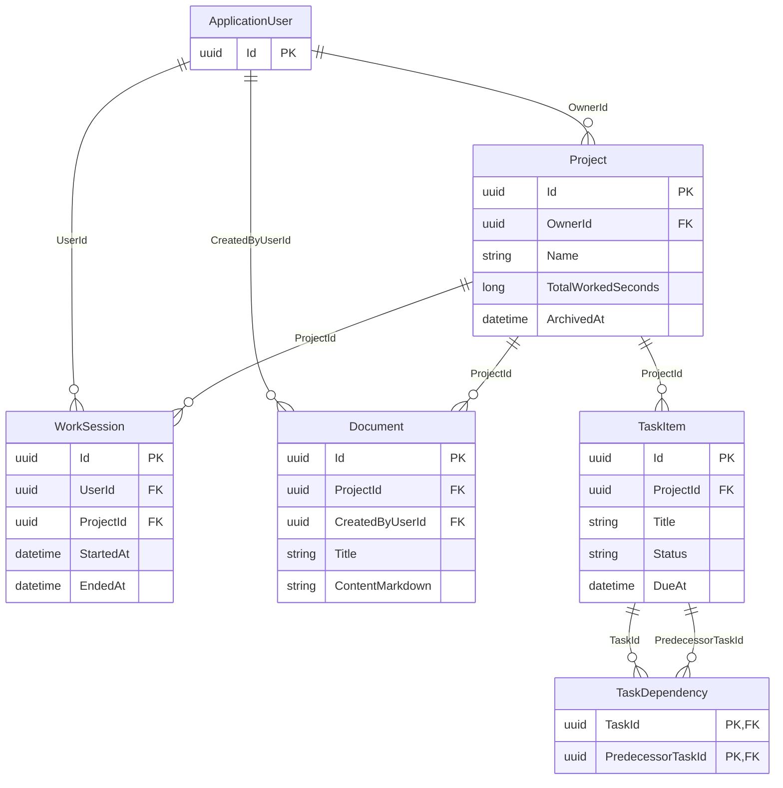
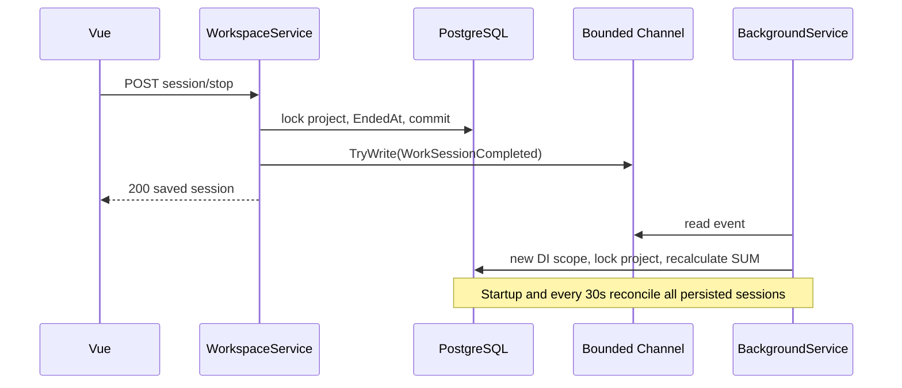

# Dokumentacja techniczna

## ERD

Aktywne encje biznesowe: User, Project, TaskItem, WorkSession, Document oraz
łącząca TaskDependency. Role/claims/tokeny to dodatkowe tabele ASP.NET Identity.
ProjectId ma kaskadowe usuwanie danych projektu, użytkownik z danymi jest
chroniony przez RESTRICT. Usuwanie poprzednika z zależnościami blokuje serwis.
Projekt można usunąć w całości; UI ostrzega, że obejmuje to historię/dokumenty.

Migracja AddWorkspaceModel rozszerza dotychczasowy model, tworzy trzy nowe
tabele i kolumnę statystyk. Indeksy: aktywna sesja (unikalny częściowy UserId,
EndedAt IS NULL), historia UserId/StartedAt/Id, sesje ProjectId/StartedAt,
dokumenty ProjectId/UpdatedAt, para TaskId/PredecessorTaskId jako PK.
Check constraints blokują koniec sesji przed początkiem i zależność od siebie.

## Reguły i współbieżność

1. Jedna aktywna sesja per użytkownik. WorkspaceService sprawdza regułę,
   a indeks bazy rozstrzyga równoległe starty także w różnych projektach.
   Naruszenie konkretnego indeksu jest mapowane na ActiveWorkSessionException/409.
2. Projekt z niezakończonym zadaniem nie może być archiwizowany. Archiwizacja
   i wszystkie zmiany projektu/zadań współdzielą SELECT FOR UPDATE rekordu
   projektu i transakcję Read Committed. Po archiwizacji POST/PATCH Tasks są
   odrzucane; usuwanie pozostaje możliwe.
3. Zadanie można zakończyć po wszystkich wymaganych poprzednikach. Graf nie
   dopuszcza cykli, self-dependency ani zadania z innego projektu. Ponowne
   otwarcie poprzednika zakończonego zadania jest odrzucane. Zmiany grafu i
   statusu korzystają z tej samej blokady projektu, więc nie mijają się w wyścigu.

Nowe serwisy i reguły znajdują się w Application. Kontrolery pobierają identyfikator
z podpisanych claims i przekazują DTO. Wszystkie odczyty/zapisy nowych zasobów
sprawdzają właściciela. Cudzy zasób daje 404, brak sesji 401, brak roli 403.

Czas pracy ustala serwer w UTC z precyzją mikrosekund PostgreSQL. Stop jest
idempotentny: nie przesuwa EndedAt przy ponowieniu. Aktywną sesję można zakończyć
po archiwizacji, ale nie można rozpocząć nowej w archiwalnym projekcie.

## Mechanizm asynchroniczny

Kolejka ma pojemność 256 i jednego czytelnika. TryWrite po commicie nie opóźnia
poprawnie zakończonej sesji, gdy kolejka jest pełna. Worker przelicza sumę
zakończonych sesji, nie dodaje jej inkrementalnie — duplikat zdarzenia nie
podwaja wyniku. Przeliczenie blokuje ten sam projekt i nie nadpisuje nowszych
wyników na podstawie starego stanu sesji.

Channel jest pamięciowy, a nie trwałym brokerem. Źródłem prawdy są rekordy
WorkSessions. Rekonsyliacja przy starcie i co 30 sekund naprawia projekcję
po restarcie lub utracie zdarzenia. Wyjątek jest logowany; ponowienie po 5 s
ponownie przelicza trwałe dane. Każda operacja workera ma nowy scope/DbContext.
Shutdown jest anulowalny; pozostawione zdarzenia odzyskuje kolejny start.
Nie gwarantujemy dostawy samego zdarzenia dokładnie raz. Outbox byłby kolejnym
krokiem dla zdarzeń powodujących efekty, których nie da się odtworzyć.

## Kontrakty HTTP

Aktualne źródło: Swagger UI `/swagger`, OpenAPI `/openapi/v1.json` w Development.
OpenAPI zawiera schemat cookie CookieAuth i security na chronionych operacjach.
Logowanie przez UI ustawia HttpOnly cookie; Swagger nie musi odczytywać go w JS.

| Zasób | Operacje |
| --- | --- |
| Auth | POST register/login/logout, GET me |
| Projects | GET/POST collection; GET/PATCH/DELETE /{id}; POST /{id}/archive |
| Tasks | GET/POST projects/{id}/tasks; GET/PATCH/DELETE /{taskId} |
| Documents | GET/POST projects/{id}/documents; GET/PUT/DELETE /{documentId} |
| Sessions | POST projects/{id}/work-sessions; GET work-sessions/active, GET /{id}, POST /{id}/stop; GET history |
| Dependencies | GET/POST projects/{id}/tasks/{taskId}/dependencies; DELETE /{predecessorId} |
| ADMIN | GET admin/users |

Wszystkie ścieżki zaczynają się od `/api`. Nowe odpowiedzi dokumentów/sesji
mają dedykowane rekordy DTO. Dokument PUT zastępuje Title/ContentMarkdown;
Tasks/Projects PATCH zachowuje pola pominięte i czyści opis/termin przy null.
Dodanie istniejącej zależności i ponowne usunięcie jej są idempotentne (204).

Tasks: pageNumber=1/pageSize=20 (maks. 100), status=0/1/2, search po tytule ILIKE
z literalnym traktowaniem wildcardów. Historia sesji: te same parametry stron,
opcjonalny projectId, kolejność StartedAt DESC/Id DESC. Nieprawidłowy offset
lub parametr daje 400, strona poza końcem daje pustą listę z prawdziwym count.

Nowe błędy 409: aktywna sesja, archiwalny projekt, cykl/zależność blokująca status
lub usunięcie poprzednika. 400 daje ValidationProblemDetails; błędy Identity
rejestracji pozostają tablicą IdentityError, normalizowaną przez klienta Vue.
Nieoczekiwane 500 nie ujawnia szczegółów; traceId prowadzi do logów.

## Frontend i bezpieczeństwo treści

Komponenty shadcn-vue wygenerowano oficjalnym CLI i przechowywane są w repo.
Reka UI zapewnia modal/focus trap. Obecne tokeny Tailwind i ciemna paleta są
zachowane. Widoki ładowane są dynamicznie; nie ma już PrimeVue/Aura.
Klient fetch obsługuje 204, błędy pól, IdentityError i ProblemDetails; chronione
401 przekierowuje na login z trasą powrotną, 403 nie wylogowuje, 429 respektuje
Retry-After. Stan cookie zawsze weryfikuje serwer. Nie przechowujemy tokenów w JS.

Markdown jest parsowany przez marked i sanitizowany przez DOMPurify przed
v-html. Testy obejmują script, onerror oraz javascript links. Dane z API nie
są traktowane jako zaufany HTML. Edycja zachowuje treść po błędzie zapisu.
